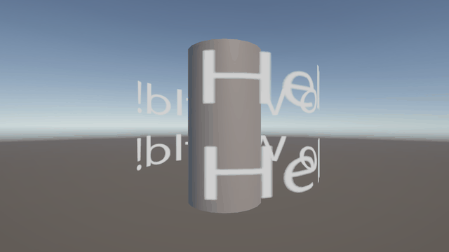
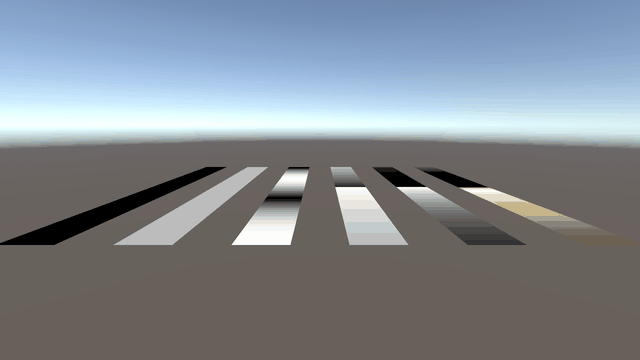
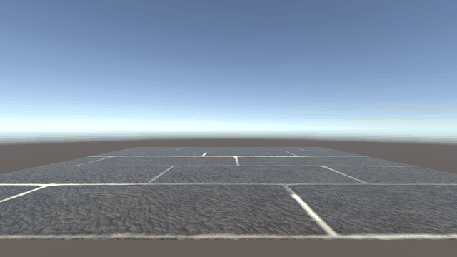
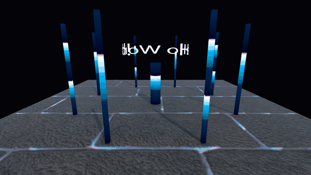

# はじめに
プログラムワークショップIVの管理用です

# 結果画像

- 工夫した点：Scene_4_MyBest で、授業の「隙間に光を流す」シェーダーの内積(波数ベクトル・位置)を「中心点からの距離」に置き換え、タイルの目地を光がリング状に広がるようにした。さらにグラデーションをネオン調の色に変え、光が縦に駆け上がる柱（周波数と波数を変えた2種類のマテリアル）と、シェーダーで回る文字リングを組み合わせ、背景を暗くして光が目立つようにした

# 進め方

- 本リポジトリをforkしてください
- fork先のリポジトリを更新してください
- Unityのプロジェクトをsrc内で進めてください
- 結果を画面キャプチャして、画像としてリポジトリに追加して、上記のリンクから見られるようにしてください
- 完成したら本リポジトリのmainブランチにpull requestを投げてください
